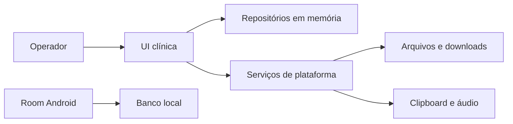

# Auditoria de segurança e privacidade

## Escopo e fronteiras

Frontend clínico local Android, Windows Desktop e Web Wasm. A análise considera um operador legítimo e outras pessoas ou aplicações com acesso ao mesmo dispositivo, perfil de navegador, clipboard ou pasta exportada. A superfície de hospedagem Web, se usada, depende da implantação. Escopo de rede e controle de acesso futuro precisam ser reavaliados quando houver infraestrutura.

O fluxo principal das três entradas usa memória. `AndroidRoomModule.kt` expõe uma implementação Room separada no Android. Os ativos incluem cadastro, responsável, anamnese, documentos, avaliações, agenda, tentativas, histórico e perfil. Os arquivos exportados e o clipboard cruzam a fronteira da aplicação para o sistema ou navegador.

## Casos de abuso e falha

| Prioridade | Caminho e evidência | Controles, correção e risco residual |
| --- | --- | --- |
| Alta | Uma pessoa com acesso ao aplicativo aberto pode navegar direto até dados clínicos. `FonoLabNavHost` começa no Dashboard e não há verificação efetiva de identidade. | O acesso ao dispositivo ou perfil é a barreira disponível. Validar o modelo operacional e planejar controle de acesso conforme o uso real. |
| Alta | O operador reinicia o aplicativo ou recarrega a página e perde o estado clínico. `FonoLabModule.kt` usa repositórios em memória nos três alvos. | Planejar persistência e recuperação com testes de reinício e bancos sintéticos. Antes de ativar Room na entrada, tratar o fallback destrutivo e o caminho v1 → v2. |
| Alta | Saída Windows ou Web pode ser lida por outra aplicação ou pessoa com acesso a Documentos, Downloads ou sincronização do sistema. Exportadores incluem dados de identificação e nome no arquivo. | Planejar confirmação de destino, nomes opacos, minimização, retenção e abertura de compartilhamento. Validar compatibilidade com os arquivos e fluxos existentes. |
| Média | Logs Desktop e Web incluíam texto de fala, títulos de compartilhamento, nomes e caminhos. O clipboard podia registrar a exceção bruta. | Removidas as mensagens com esses campos e substituídas falhas de clipboard e explorador por diagnósticos fixos. O contrato de logger comum ainda permite mensagens e exceções arbitrárias. Ao usá-lo, registrar códigos e metadados sanitizados. |
| Média | Dados copiados no Windows ou Web ficam disponíveis às APIs de clipboard segundo regras do sistema. O Web pode negar a operação. | A revisão mantém os fluxos existentes de cópia. Auditar consentimento, mensagens de falha e retenção quando a política de exportação for definida. |
| Média | A gravação de anamnese e sua versão ocorre em chamadas DAO separadas. Interrupção ou concorrência pode quebrar a rastreabilidade. | Testar transação com falha injetada antes de ligar Room à UI. |

O manifesto Android define `allowBackup=false` e configura regras de extração. A Activity de launcher é exportada. O manifesto inspecionado não declara permissões de rede ou armazenamento. Verificar também o manifesto mesclado por variante, pois bibliotecas podem adicionar componentes ou permissões. A revisão estática não estabelece criptografia em repouso, isolamento por profissional ou conformidade com a LGPD.

## Validação

- Inspeção das entradas, DI, DAOs, esquemas e adaptadores, com revisão dos pontos de saída para log, clipboard e exportação. Validar em runtime com um nome sintético identificável e inspecionar stdout, Logcat e console do navegador.
- A verificação local de padrões em arquivos rastreados é triagem. Gitleaks e OSV-Scanner não estavam instalados. As dependências resolvidas, o histórico completo e os artefatos precisam de varredura dedicada antes de release.
- Referências de controle. [OWASP MASVS](https://mas.owasp.org/MASVS/), [OWASP ASVS](https://owasp.org/www-project-application-security-verification-standard/) e [ANPD](https://www.gov.br/anpd/).
